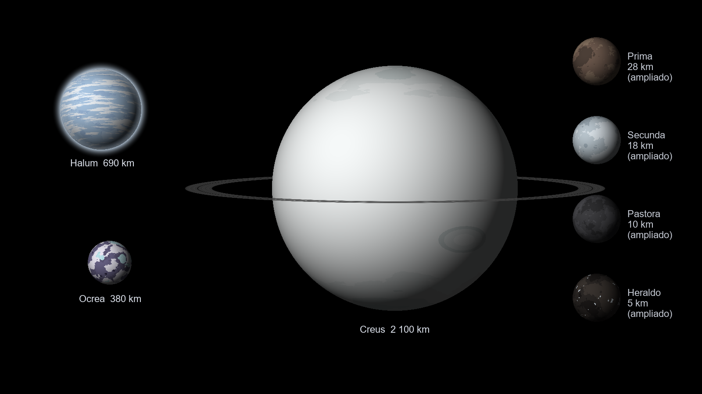
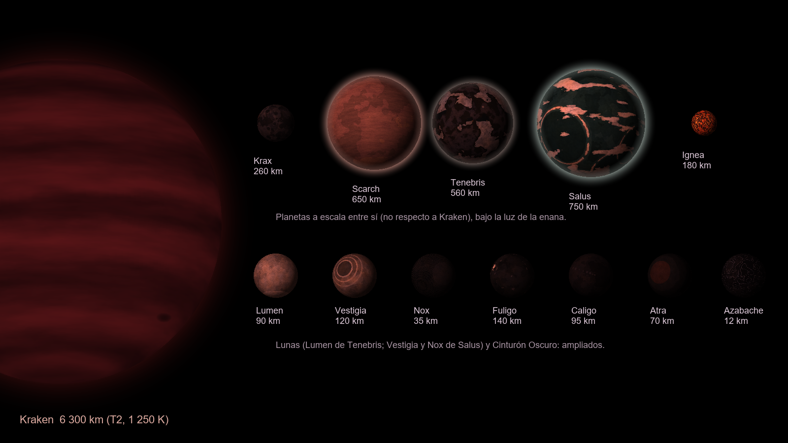

# Mundos Lejanos — planet pack para Kopernicus

Dos sistemas lejanos de Kerbol, en un solo pack.

### Sistema Creus–Halum (800 KAU)
Un binario errante capturado por Kerbol:
- **Creus**, un gigante de hielo blanco con anillo oscuro;
- **Halum**, un mundo de hidrógeno con océano de neón y 7 atm, a 5 KAU de Creus;
- **Ocrea**, una luna retrógrada cubierta de escarcha de hidrógeno y glaciares de neón, a ~6 K;
- **Pastora**, una luna pastora del anillo;
- **Prima** y **Secunda**, los troyanos de Halum;
- **Heraldo**, un cometa que visita el sistema interior.



### Sistema Kraken (2 años luz kerbales)
Una enana marrón T2 de bandas granate y luz rojo-violeta, rodeada de tres discos:
- **Krax**, un mundo de carbono abrasador donde se replican las máquinas;
- **Scarch**, una sauna volcánica de 25 atm que las máquinas están desmontando;
- **Tenebris**, un mundo oscuro de bosques negros y hogar de la colonia kerbal, con **Lumen**, su luna de hielo brillante;
- **Salus**, un océano hipersalino que pasó por hiceano, con sus lunas **Vestigia** (restos del gran impacto) y **Nox** (capturada);
- **Ignea**, una protoplaneta con océano de magma dentro del disco protoplanetario;
- el **Cinturón Oscuro**: los planetas enanos Fuligo, Caligo y Atra y 5 asteroides, casi invisibles (albedo de 0.01 a 0.02).



> Las texturas actuales son **provisionales**, generadas por código. Las listas de las que hay que pintar están en
> [docs/TEXTURAS.md](docs/TEXTURAS.md) (Creus–Halum) y [docs/kraken/TEXTURAS.md](docs/kraken/TEXTURAS.md) (Kraken).

## Instalación

1. Copia `GameData/MundosLejanos` en `Kerbal Space Program/GameData/`.
2. Dependencias:

| Mod | Para qué |
|---|---|
| Kopernicus (probado con 1.12.1-247) | Planetas y estrellas |
| ModuleManager | Parches de antena y ciencia |
| **CTTP** (Community Terrain Texture Pack) | Texturas de detalle del suelo. Suele venir con OPM |
| Parallax Continued + Parallax_StockScatterTextures | *Opcional*: rocas, flora negra y **las máquinas** de Kraken. Sin ellos el pack funciona, pero sin scatters |
| Scatterer + StockScattererConfigs | *Opcional*: atmósferas, océanos y destello de Kraken |
| EVE (Blackrack) + StockVolumetricClouds | *Opcional*: nubes 2D y volumétricas V5 |
| PlanetShine | *Opcional*: luz reflejada por cada mundo |

Opcional: BetterTimeWarp, para tasas de warp por encima de 100 000×. Para llegar a Kraken hace falta un mod de viaje superlumínico.

Es compatible con OPM: no toca ninguno de sus cuerpos. La primera carga es lenta porque Kopernicus construye su caché.

## Estructura

```
GameData/MundosLejanos/
  Configs/
    CreusHalum/            Creus, Halum, Ocrea, CuerposMenores, CommNet (RA-K) y Ciencia
    Kraken/                Kraken (estrella y 3 discos), Krax, Scarch, Tenebris, Salus, Ignea, Ciencia;
                           Lunas y CinturonOscuro (generados); Parallax_Scatters y Parallax_PQS (generados)
    Visuales/              Scatterer, EVE y PlanetShine (generados, opcionales)
  PluginData/<Cuerpo>/     texturas (en PluginData para que KSP no las precargue)
herramientas/
  sistema.py               parámetros de ambos sistemas: fuente única de verdad
  generar_atmosferas.py    curvas hidrostáticas, que inyecta en los .cfg
  generar_texturas.py      texturas provisionales
  generar_cuerpos_menores.py  configs de las lunas y del Cinturón Oscuro de Kraken
  generar_scatters.py      scatters de Parallax y su PQSMod
  generar_visuales.py      configs de Scatterer, EVE y PlanetShine, y texturas de EVE
  generar_referencias.py   láminas de referencia para el artista (PNG + PDF)
  previsualizar.py         vistas previas de docs/
  validar_pack.py          comprobación completa sin abrir KSP
docs/
  CONCEPTO_CREUS_HALUM.md  historia, estructura interna y lugares con nombre
  DISENO.md / TEXTURAS.md  Creus–Halum
  kraken/DISENO.md         Kraken: decisiones, física, máquinas y colonia
  kraken/TEXTURAS.md       Kraken: lista de texturas y modelos 3D
  referencias_artista/     20 láminas y MundosLejanos_referencias.pdf, para el artista
```

## Flujo de trabajo

Necesita Python 3 con `numpy` y `Pillow`.

```bash
python herramientas/generar_atmosferas.py
```
Tras cambiar `ATMOS` en `sistema.py`, regenera las curvas de presión y temperatura.

```bash
python herramientas/generar_texturas.py
```
Regenera las texturas provisionales. Con argumentos (por ejemplo `Scarch Tenebris`) solo regenera esos cuerpos.

```bash
python herramientas/generar_scatters.py
```
Regenera los scatters de Parallax a partir de las configs de Parallax instaladas, junto con su parche de PQSMod.

```bash
python herramientas/generar_visuales.py
```
Regenera los configs de Scatterer, EVE y PlanetShine. Ejecútalo después de cambiar las texturas.

```bash
python herramientas/generar_referencias.py
```
Regenera las láminas para el artista.

```bash
python herramientas/validar_pack.py
```
Ejecútalo antes de cada prueba en el juego. Comprueba:
- la sintaxis y las rutas;
- que los colores de bioma coinciden con los mapas;
- que las SOI no se solapan;
- las curvas de atmósfera y la luminosidad de la estrella;
- los modelos y biomas de los scatters;
- las claves de ciencia.

xd
