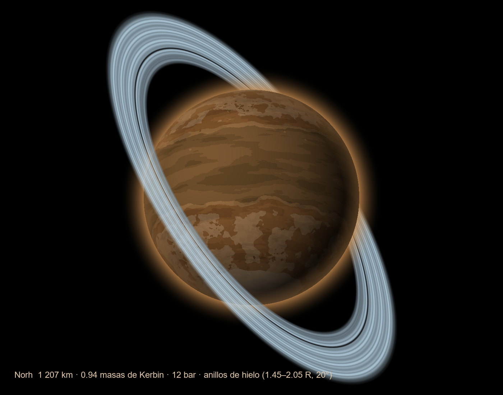
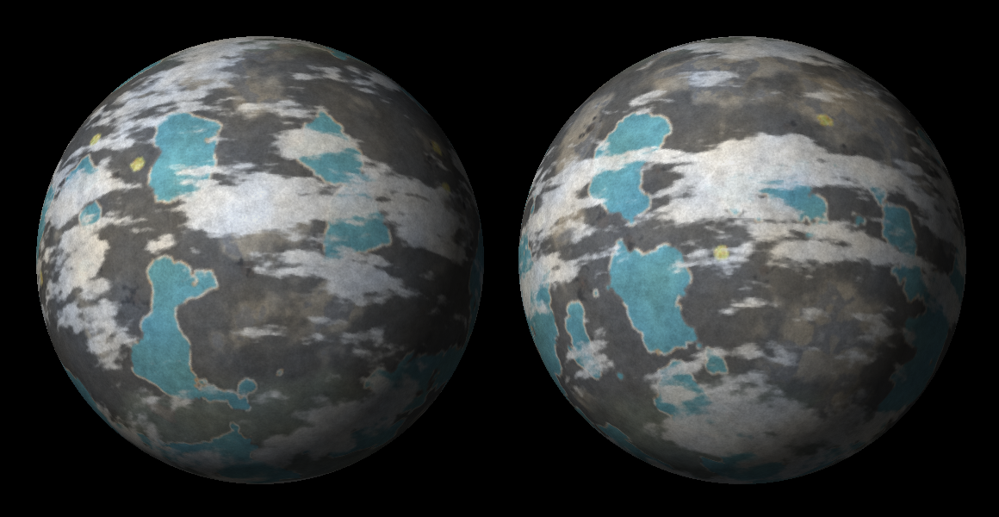
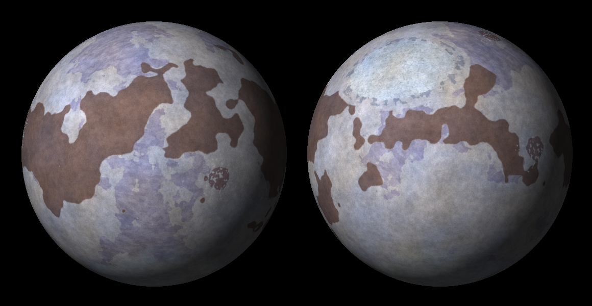

#  FarBeyond, planet pack para la hermosa comunidad de El Hangar de Jeb

Dos sistemas lejanos de Kerbol y, en el propio sistema de Kerbol, dos planetas nuevos, tres planetas enanos y sus lunas, en un solo pack.

### Sistema Creus–Halum (800 KAU)
Un binario errante capturado por Kerbol:
- **Creus**, un gigante de hielo blanco con anillo oscuro;
- **Halum**, un mundo de hidrógeno con océano de neón y 7 atm, a 5 KAU de Creus;
- **Ocrea**, una luna retrógrada cubierta de escarcha de hidrógeno y glaciares de neón, a ~6 K;
- **Pastora**, una luna pastora del anillo;
- **Prima** y **Secunda**, los troyanos de Halum;
- **Heraldo**, un cometa que visita el sistema interior.


### Sistema Kraken (0.2 años luz kerbales, ~12 650 KAU)
Una enana marrón T2 de bandas granate y luz rojiza y tenue, rodeada de tres discos:
- **Krax**, un mundo de carbono abrasador donde se replican las máquinas;
- **Scarch**, una sauna volcánica de 25 atm que las máquinas están desmontando;
- **Tenebris**, un mundo frío y oscuro bajo una tenue capa de metano, con océanos helados y agua líquida solo en el ecuador, donde quizá haya vida y los kerbals han fundado una colonia en cúpulas; su luna **Lumen** es de hielo sucio, con géiseres en el polo sur;
- **Salus**, un océano hipersalino que pasó por hiceano, con sus lunas **Vestigia** (restos del gran impacto) y **Nox** (capturada);
- **Ignea**, una protoplaneta con océano de magma dentro del disco protoplanetario;
- el **Cinturón Oscuro**: los planetas enanos Fuligo, Caligo y Atra y 5 asteroides, casi invisibles (albedo de 0.01 a 0.02).


### Norh (sistema de Kerbol, troyano de Jool)
Un mundo rocoso del tamaño de Kerbin que comparte órbita con Jool y lo sigue 60° por detrás:
- 12 bar de nitrógeno, hidrógeno y amoníaco, que lo mantienen a −40 °C en el ecuador;
- una banda de agua con amoníaco líquida alrededor del ecuador y polos helados;
- ningún cráter, decenas de volcanes y el **Gran Volcán**, una isla de 9 km;
- anillos de hielo jóvenes, aún inclinados 20°.



### Skolta (sistema de Kerbol, entre Duna y Dres)
Un "Titán cálido" del tamaño de Kerbin, en una órbita inclinada 19°:
- 4 bar de nitrógeno, amoníaco y metano bajo una bruma naranja, a unos −40 °C;
- un mar incoloro de amoníaco con hidracina disuelta (un monopropelente natural), casi negro mar adentro;
- tierras altas blancas, dunas oscuras, bahías azules de azufre y yacimientos de cobre;
- su luna **Ceniza**, una roca parda capturada del cinturón, con el Monte Solitario.


### Termos y Talia (cinturones del sistema de Kerbol)
Dos planetas enanos que reciben buena parte de los impactos de sus cinturones:
- **Termos** (entre Skolta y Dres), el 60 % de la masa de su cinturón. Es muy activo:
  - 5 atm de nitrógeno, CO₂, vapor y amoníaco, a más de 100 °C;
  - lagos inmensos de agua lechosa casi hirviendo (a 5 atm hierve a 152 °C), con terrazas blancas de sílice;
  - volcanes y pozos ácidos de colores en los trópicos.
- Sus lunas: **Tyrna**, helada, criovolcánica y llena de metales, y **Karmen**, un fragmento metálico capturado.
- **Talia** (cinturón exterior, entre Dres y Jool), muerta y saturada de cráteres: la Gran Cuenca y afloramientos de hierro y níquel.



### Akira (200 KAU)
Un mundo transneidoniano de hielos de nitrógeno y metano, de 900 km:
- excepcionalmente activo, con criovolcanes y un glaciar de nitrógeno que se remueve en celdas;
- una atmósfera sorprendentemente densa (1.2 atm) a −211 °C, bajo un cielo azul oscuro.



> Las texturas actuales son **provisionales**, generadas por código. Las listas de las que hay que pintar están en
> [docs/TEXTURAS.md](docs/TEXTURAS.md) (Creus–Halum) y [docs/kraken/TEXTURAS.md](docs/kraken/TEXTURAS.md) (Kraken). Norh: [docs/norh/DISENO.md](docs/norh/DISENO.md). Skolta: [docs/skolta/DISENO.md](docs/skolta/DISENO.md).
> Termos, Tyrna, Karmen y Talia: [docs/termos/DISENO.md](docs/termos/DISENO.md). Akira: [docs/akira/DISENO.md](docs/akira/DISENO.md).

## Instalación

1. Copia `GameData/MundosLejanos` en `Kerbal Space Program/GameData/`.
2. Dependencias:

| Mod | Para qué |
|---|---|
| Kopernicus (probado con 1.12.1-247) | Planetas y estrellas |
| ModuleManager | Parches de antena y ciencia |
| **CTTP** (Community Terrain Texture Pack) | *Recomendado*: texturas de detalle del suelo. Sin CTTP, el pack usa sus propias texturas de respaldo (`PluginData/Terreno`), más simples |
| Parallax Continued + Parallax_StockScatterTextures | *Opcional*: rocas, cristales y **las máquinas** de Kraken. Sin ellos el pack funciona, pero sin scatters |
| Scatterer + StockScattererConfigs | *Opcional*: atmósferas, océanos y destello de Kraken |
| EVE (Blackrack) + StockVolumetricClouds | *Opcional*: nubes 2D y volumétricas V5 |
| PlanetShine | *Opcional*: luz reflejada por cada mundo |

Opcional: BetterTimeWarp, para tasas de warp por encima de 100 000×. Para llegar a Kraken hace falta un mod de viaje superlumínico.

Es compatible con OPM: no toca ninguno de sus cuerpos. La primera carga es lenta porque Kopernicus construye su caché.

## Estructura

```
GameData/MundosLejanos/
  Configs/
    CreusHalum/            Creus, Halum, Ocrea, CuerposMenores, CommNet (RA-K) y Ciencia
    Kraken/                Kraken (estrella y 3 discos), Krax, Scarch, Tenebris, Salus, Ignea, Ciencia;
                           Lunas y CinturonOscuro (generados); Parallax_Scatters y Parallax_PQS (generados)
    Norh/                  Norh y su Ciencia
    Skolta/                Skolta, Ceniza (generado) y su Ciencia
    Termos/                Termos, sus lunas Tyrna y Karmen (Lunas, generado) y su Ciencia
    Talia/                 Talia y su Ciencia
    Akira/                 Akira y su Ciencia
    Visuales/              Scatterer, EVE y PlanetShine (generados, opcionales)
    Respaldo_CTTP.cfg      texturas de suelo propias si falta CTTP (generado)
  PluginData/<Cuerpo>/     texturas (en PluginData para que KSP no las precargue)
  PluginData/Terreno/      texturas de detalle de respaldo (sustituyen a CTTP si falta)
herramientas/
  sistema.py               parámetros de ambos sistemas: fuente única de verdad
  generar_atmosferas.py    curvas hidrostáticas, que inyecta en los .cfg
  generar_texturas.py      texturas provisionales
  generar_cuerpos_menores.py  configs de las lunas y del Cinturón Oscuro de Kraken
  generar_scatters.py      scatters de Parallax y su PQSMod
  generar_visuales.py      configs de Scatterer, EVE y PlanetShine, y texturas de EVE
  generar_referencias.py   láminas de referencia para el artista (PNG + PDF)
  previsualizar.py         vistas previas de docs/
  generar_terreno.py       texturas de detalle de respaldo y su parche, para cuando falta CTTP
  validar_pack.py          comprobación completa sin abrir KSP
  construir.py             versión instalable con DDS en build/ (y --instalar: la copia a KSP)
  empaquetar.py            zip para playtesters: Descargas/ehdj_rp-v<versión>.zip
arte/                      fuentes del artista que usan los generadores (Kraken_Textura.png)
docs/
  CONCEPTO_CREUS_HALUM.md  historia, estructura interna y lugares con nombre
  DISENO.md / TEXTURAS.md  Creus–Halum
  kraken/DISENO.md         Kraken: decisiones, física, máquinas y colonia
  kraken/TEXTURAS.md       Kraken: lista de texturas y modelos 3D
  norh/DISENO.md           Norh: datos, física, biomas y texturas
  skolta/DISENO.md         Skolta: cómo se llevó la ficha del equipo al juego
  termos/DISENO.md         Termos, Tyrna, Karmen y Talia: escala, decisiones y biomas
  akira/DISENO.md          Akira: escala, atmósfera y biomas
  referencias_artista/     28 láminas y MundosLejanos_referencias.pdf, para el artista
```

## Flujo de trabajo

Necesita Python 3 con `numpy` y `Pillow`.

```bash
python herramientas/generar_atmosferas.py
```
Tras cambiar `ATMOS` en `sistema.py`, regenera las curvas de presión y temperatura.

```bash
python herramientas/generar_texturas.py
```
Regenera las texturas provisionales. Con argumentos (por ejemplo `Scarch Tenebris`) solo regenera esos cuerpos.

```bash
python herramientas/generar_scatters.py
```
Regenera los scatters de Parallax a partir de las configs de Parallax instaladas, junto con su parche de PQSMod.

```bash
python herramientas/generar_visuales.py
```
Regenera los configs de Scatterer, EVE y PlanetShine. Ejecútalo después de cambiar las texturas.

```bash
python herramientas/generar_referencias.py
```
Regenera las láminas para el artista.

```bash
python herramientas/generar_terreno.py
```
Regenera las texturas de detalle de respaldo y `Configs/Respaldo_CTTP.cfg`. Ejecútalo si cambias alguna ruta de CTTP en los .cfg: el parche solo se aplica cuando CTTP no está instalado.

```bash
python herramientas/validar_pack.py
```
Ejecútalo antes de cada prueba en el juego. Comprueba:
- la sintaxis y las rutas;
- que los colores de bioma coinciden con los mapas;
- que las SOI no se solapan;
- las curvas de atmósfera y la luminosidad de la estrella;
- los modelos y biomas de los scatters;
- las claves de ciencia.

```bash
python herramientas/construir.py --instalar
```
Construye la versión instalable en `build/GameData/MundosLejanos` y la copia al GameData de KSP.
- Las fuentes siguen en PNG. Aquí se pasan a DDS (DXT5 o DXT1, con mipmaps y volteados como exige KSP) las texturas que van a la GPU: vista lejana, normales, anillos, estrella y detalle del terreno.
- Siguen en PNG los mapas que KSP lee en la CPU: alturas, biomas y mapas de color del terreno.
- En la copia se reescriben las rutas de los .cfg. **Instala siempre así**: copiar `GameData/MundosLejanos` a mano dejaría las texturas en PNG.

```bash
python herramientas/empaquetar.py
```
Crea el zip para los playtesters en tu carpeta de Descargas: `ehdj_rp-v<versión>.zip`. Usa la versión con DDS de `build/`.
- La versión sale del archivo `VERSION` y sube sola tras cada zip (0.0.120, 0.0.121…).
- Antes de empaquetar pasa el validador: si hay errores, no crea el zip.
