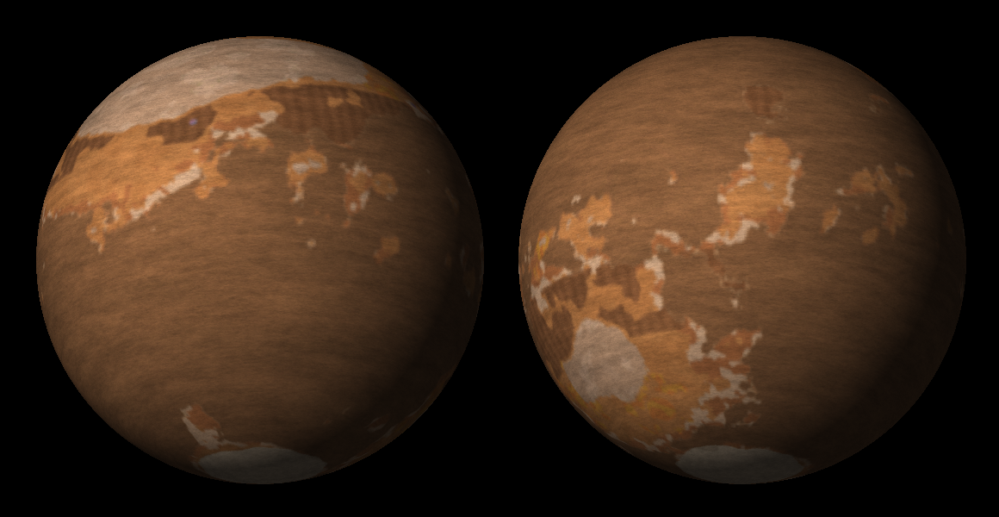

# Skolta: implementación en KSP

Se basa en la ficha del equipo **"Skolta - ficha del planeta (KSP)"** (Claude Docs, 2026-10-11). La física, la química y la historia están en esa ficha. Aquí solo se recogen los valores que se usaron en el juego y las decisiones que la ficha dejaba abiertas.

## Valores fijados en la ficha

| | Valor | En el pack |
|---|---|---|
| Órbita | Año de 365.25 días de 24 h → a = 30.9 Gm, e = 0.05, i = 19° | `sistema.py` calcula a = (μ T² / 4π²)^(1/3) = 30 924 287 662 m |
| Posición | ~2.3 KAU, entre Duna y Dres | El validador comprueba que no cruza a Duna ni a Dres (periapsis 29.4 Gm, apoapsis 32.5 Gm) |
| Tamaño | 0.75 g, radio de 650 km | μ = 3.11e12 m³/s², SOI 182 Mm |
| Atmósfera | 3-5 bar de N₂ con NH₃ (15-30 %), CH₄ (2-5 %) y bruma orgánica | **4 bar**: 76 % N₂, 21 % NH₃, 3 % CH₄. Masa molar 25.4 g/mol |
| Temperatura | ~230 K (210-250 K) | 238 K en el ecuador y ~212 K en los polos (curva de latitud). Media ≈ 230 K |
| Densidad del aire | 4.9 kg/m³ en la ficha | 5.1 kg/m³. Techo a 133 km |
| Mar | NH₃ con hidracina, densidad 0.7-0.8, 60-70 % de la superficie | `Ocean { density = 0.75 }`. El 64 % del área queda bajo el nivel del mar |
| Color del mar | Incoloro: toma el color del fondo (subsección "Color del mar") | Fondo somero crema `#D6CDB2`, marrón `#4A3326` junto a las dunas, profundo `#3A3028`; bahías `#2F4C9E`, cobre `#4E7BE0`. Océano `color` = `#3A3028`, `colorFromSpace` pardo oscuro (`0.33,0.28,0.22`). Vista lejana: `#4A3E31` con borde claro `#C9BD9C` y brillo especular (alfa de `_Color`). Antes era gris ámbar `#8C7A62` bajo un 72 % de bruma, y en el playtest el mar casi no se distinguía |
| Colores | Paleta de la sección "Material gráfico" | Mismos códigos (ver la tabla de abajo) |
| Sin oxígeno | | `oxygen = false`: los motores de reacción no funcionan |

## Decisiones abiertas en la ficha: qué se eligió

En cada caso se tomó la **propuesta de la propia ficha**. Todas se pueden cambiar.

| Decisión | Elegido | Dónde se cambia |
|---|---|---|
| Rotación | Día solar de 24 h (sideral de 86 164 s) | `Skolta.cfg › rotationPeriod` |
| Inclinación axial ~23° | **No se puede**: KSP no tiene inclinación axial. Sin estaciones | — |
| Luna | Una luna mediana: **Ceniza**, R = 175 km, 0.10 g, a 13.5 Mm (2 días), inclinada 18°, capturada del cinturón, de arcillas amoniacadas como Ceres | `sistema.py` y `generar_cuerpos_menores.py` |
| Nombres | Estilo descriptivo en español, como el resto del pack: "Ceniza" para la luna, y para los biomas los nombres genéricos de la tabla de la ficha | `generar_texturas.BIOMES` y los .cfg |
| Biomas | Los 11 de la ficha | ídem |
| Arena | Dunas oscuras (`#4A3326`/`#2E1F18`), que contrastan con el mar pálido | `generar_texturas.skolta()` |
| Relieve | Tierras altas y mares grandes: un continente al norte (~100° de longitud) y otro menor al sur, más archipiélagos ecuatoriales | ídem |
| Campo magnético | Sin efecto en KSP | — |
| Atmósfera exacta | 4 bar y 21 % de NH₃: el centro de los rangos de la ficha | `sistema.ATMOS["Skolta"]` y después `generar_atmosferas.py` |
| Mar pálido o ámbar | Pálido (incoloro). El tinte ámbar por orgánicos disueltos (`#B58A4E`) queda como opción | Colores del mar en `generar_texturas.skolta()` y `Ocean` en `Skolta.cfg` |

Para darle un rasgo único a Ceniza, añadí el **Monte Solitario** (12° N, 75° E). Es un domo criovolcánico de 3 km como Ahuna Mons en Ceres, y tiene su propio bioma (×1.6 de ciencia).

## Mapa y biomas

| Bioma | Color del mapa | × ciencia | Dónde |
|---|---|---|---|
| Mar | `#2050a0` | 1.0 | 64 % del área |
| Bahías Azules | `#0020ff` | 1.4 | Mar junto a los campos volcánicos (azufre disuelto) |
| Costas | `#a05030` | 1.1 | Deltas, primeros 200 m sobre el mar |
| Salinas | `#fff0c0` | 1.2 | Parte de la costa |
| Llanuras | `#d09040` | 1.0 | Tierra baja, ocre |
| Dunas | `#403020` | 1.1 | Cinturones secos entre 15° y 35° |
| Tierras Altas | `#e0e0e0` | 1.1 | Interior de los continentes, anortosita |
| Montañas | `#808080` | 1.3 | Por encima de 3 500 m (máximo ~7.9 km) |
| Campos Volcánicos | `#ffd000` | 1.4 | 5 campos: uno en un archipiélago ecuatorial y el resto en contactos entre tierras altas y cuencas |
| Yacimientos Metálicos | `#a040ff` | 1.6 | 4 manchas pequeñas de cobre y níquel, azules y violetas |
| Casquetes Polares | `#c0ffff` | 1.2 | Más allá de ~74° |

**Vista desde el espacio.** Es como Titán: bruma naranja (`#D68B52` → `#A86C3F`, en degradado) al 58 %, sobre el terreno difuminado al 42 %. Se distinguen:
- el continente blanco;
- el mar, oscuro mar adentro, con el borde claro de las costas y el reflejo de Kerbol;
- las dunas;
- los casquetes de color crema.

## Visuales opcionales

- **Scatterer:** cielo naranja oscuro con mucha bruma; mar incoloro y transparente (n = 1.35), casi negro en lo profundo, que refleja el cielo naranja; Ceniza proyecta eclipses.
- **EVE:** nubes de NH₃ color crema entre 3 y 10 km.
- **PlanetShine:** albedo 0.35.
- **Parallax:** rocas de anortosita en las tierras altas, losas de basalto en las llanuras y los campos volcánicos, y rocas azules de cobre en los yacimientos.
- **Sin CTTP:** el terreno usa las texturas de respaldo (`Respaldo_CTTP.cfg`).

## Archivos

| Archivo | Qué es |
|---|---|
| `Configs/Skolta/Skolta.cfg` | Cuerpo, órbita, atmósfera (bloque generado), PQS y océano |
| `Configs/Skolta/Ceniza.cfg` | La luna (generado por `generar_cuerpos_menores.py`) |
| `Configs/Skolta/Ciencia.cfg` | Textos de ciencia de Skolta y Ceniza |
| `PluginData/Skolta/Skolta_{Color,Surface,Height,Normal,Biomes}.png` | Mapas provisionales |
| `PluginData/Ceniza/Ceniza_{Color,Height,Normal,Biomes}.png` | Mapas provisionales de la luna |

Las láminas para el artista son `docs/referencias_artista/21_Skolta.png` y `22_Ceniza.png`.

## Pendiente

- **Probarlo en el juego.** Hay que comprobar sobre todo que el mar se ve crema en la orilla y oscuro mar adentro, que las naves flotan con la densidad de 0.75 y que el cielo es naranja.
- **Dudas científicas de la ficha.** No afectan al juego: el modelo radiativo, el punto de congelación de NH₃ con N₂H₄ y el blindaje UV.
